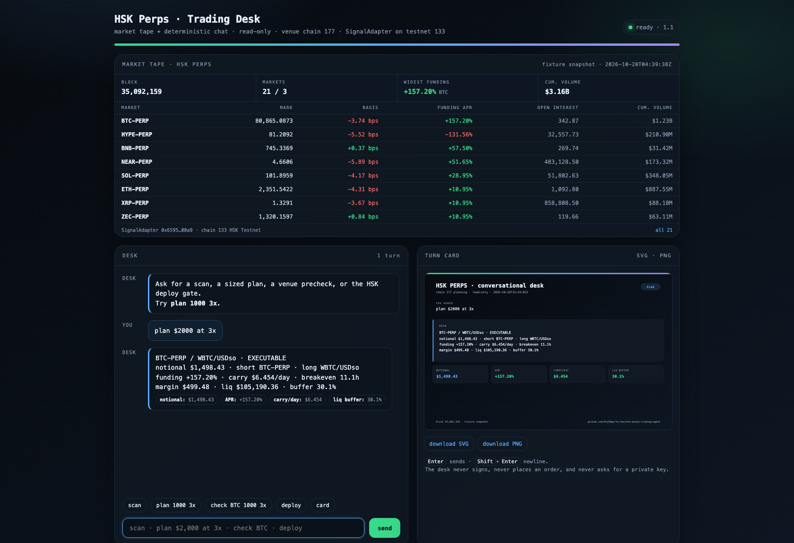

# HSK Perps Trading Agent

An AI-agent trading engine for [HSK Chain](https://hsk.xyz) (chain **177**), built for the
**HSK Chain Horizon Hackathon — Track 1: AI Agent Trading**.

It watches perp funding, normalises it correctly, sizes both legs on the venue's own grid,
checks before it sends, and mirrors every decision into an on-chain `SignalAdapter` so the
history can be audited without trusting the operator.

```
264 tests · stdlib-only Python · chain 177 verified live · testnet 133 deployed
```

---

## Status: live on HSK testnet, mainnet gate still open

HSK Chain Horizon requires the deployment explicitly:

> Make sure you deploy your smart contract on HSK Chain mainnet, projects that have not
> completed deployment will be automatically deemed to have forfeited their eligibility
> for demo selection.

The contract is deployed and exercised on **HSK testnet (chain 133)**:

| what | value |
| --- | --- |
| `SignalAdapter` | `0x6595d7079cbdc72d52086ef7381364e23c5f00a9` |
| deploy tx | `0x4bb8794d3a16e13d2c422f45da6bc6f24300ea6c5b0f9d91a43e57c5ba716332` |
| deploy receipt | block 35,001,340 · status 1 · 344,625 gas · 0.00068925 HSK |
| publish tx | `0x82c8fa93a50f55bd79a74f3f78755855175156d1b4c675f0fafde244a4c300d4` |
| publish receipt | block 35,001,358 · status 1 · 90,831 gas · 0.000181662 HSK |
| readback | `get("btc-funding")` → `edgeBps 15720`; `isActionable()` true at read time |

The published row was deliberately given an 895-second TTL, so the expiry path is exercised
rather than declared: it reads `false` now, which is the contract doing its job. The full
record, with timestamps and the signal key, is
[`deployments/testnet.json`](deployments/testnet.json). `verify.py` reads that file and checks
the bytecode and `publisher()` over the live testnet RPC.

Mainnet is the remaining gate, and it is arithmetic, not code:

```console
$ python3 scripts/hsk_deploy.py
chain      hsk (177)  block 29,423,746
publisher  0x72Aa6edDE71B94f6b99c8e52EdC02B5C75F74d1a
gas        base 500 gwei + tip 1 gwei = 501 gwei
estimate   348,527 gas (eth_estimateGas)  ·  cost 0.218265 HSK
gate       blocked: 0.000000 HSK on hsk (chain 177), need ~0.218265, short 0.218265 HSK
```

The publisher holds **0 HSK** on mainnet. 0.218 HSK is the whole distance between this
repository and a rule-compliant mainnet entry. The same deploy on testnet costs 0.000871 HSK
at 1 gwei, which is why the rehearsal is real and not a mock.

I will not call a testnet deploy a mainnet one. Every hash below names its chain, and the
mainnet row stays open until it is not.

---

## What actually works, right now

| piece | state | evidence |
| --- | --- | --- |
| Chain adapter (177 / 133) | live | `HSK_LIVE=1 pytest tests/test_hsk.py` → 41 passed |
| keccak-256 + ABI encoding | verified against Ethereum vectors | `tests/test_keccak.py` |
| Selector ↔ Solidity agreement | checked by parsing the `.sol` | `test_selectors_come_from_the_solidity_source` |
| `SignalAdapter.sol` | compiles, 1552 bytes | `npx solc@0.8.26` → `build/` |
| Testnet deployment | live, chain 133 | bytecode + `publisher()` re-read by `verify.py` |
| Deploy gate + plan | prices mainnet honestly, refuses while unfunded | the console block above |
| Conversational desk + market tape | 58 tests | `tests/test_chat.py`, `tests/test_webchat.py` |
| Funding analytics engine | 155 tests | inherited, disclosed below |

## HSK Chain: what was verified, not assumed

Both ids were read from the live RPC on 2026-10-28, and the test suite asserts them:

```
eth_chainId  https://mainnet.hsk.xyz  -> 0xb1  (177)
eth_chainId  https://testnet.hsk.xyz  -> 0x85  (133)
```

`agent/hsk.py` holds the adapter: a stdlib JSON-RPC client, strict ABI encoders, the signal
key/row codec, and the deployment gate. Two details worth naming because they are the ones
that bite:

- **`hashlib.sha3_256` is not keccak256.** It pads with `0x06`; Ethereum pads with `0x01`.
  Every selector built from hashlib is silently wrong, and a call to a non-existent selector
  returns `0x`, which decodes as `False` and looks exactly like a stale signal. Hence
  `agent/keccak.py` and its vectors.
- **HSK's public RPC answers `403` to urllib's default user agent** while accepting the same
  request from curl. The live test caught it. Without the header, a failed call is
  indistinguishable from a zero balance, and the deploy gate would say "no funds" when it
  meant "cannot reach the node".

## `SignalAdapter.sol`

It does not trade. It publishes the decision, with the block it was made at and the block
after which it is stale.

```solidity
function publish(bytes32 key, int256 edgeBps, uint64 expiresAt) external onlyPublisher returns (uint256);
function revoke(bytes32 key) external onlyPublisher;
function get(bytes32 key) external view returns (Signal memory);
function isActionable(bytes32 key) external view returns (bool);
```

Why a deployment is worth anything here: an off-chain bot's track record is whatever its
operator says it is. A signal written once, never overwritten, and expiring on its own is a
claim you can check without trusting the author. `publish` refuses an expiry that has already
passed — a signal dead on arrival looks like evidence and is not.

## Provenance (required disclosure)

The funding-analytics engine is our own prior work, carried over unchanged and disclosed as
the hackathon rules require:

- **Reused:** `agent/` analytics (funding normalisation, risk, sizing, strategy, indexer,
  terminal, card) and its 155 tests, from `dreamdex-perps-agent`, previously built for
  DreamDEX/Somnia.
- **Built for this submission:** `agent/keccak.py`, `agent/hsk.py`, `contracts/SignalAdapter.sol`,
  `scripts/hsk_deploy.py`, `scripts/hsk_send.py`, `scripts/hsk_signal.py`, `tests/test_keccak.py`,
  `tests/test_hsk.py` — 51 new tests.
- **Added this round:** the conversational desk (`agent/chat.py`, `agent/chatcard.py`,
  `agent/webchat.py`, `tests/test_chat.py`, `tests/test_webchat.py`) and the live-fee rewrite of
  the deploy gate, the market tape and the testnet deployment record — 58 more tests, 264 total.
- **Not reused:** no Somnia contract address, chain id, or market singleton is used on HSK.
  The HSK adapter does not import the Somnia config and refuses to invent an HSKswap router
  address it could not verify.

The engine is chain-agnostic on purpose: it reads a venue, and a venue is a config. What is
HSK-specific is the chain, the deploy, and the signal contract.

## The conversational desk

The CLI answers questions, not just flags. Routing is a regex table, not a language model, so
the same question returns the same numbers and a typo cannot invent a market:

```console
$ python3 -m agent chat --fixture
HSK perps desk  ·  deterministic intents  ·  read-only
ask `help` for commands, `/quit` to leave

you › plan $2000 at 3x

BTC-PERP / WBTC/USDso · EXECUTABLE
notional $1,498.43 · short BTC-PERP · long WBTC/USDso
funding +157.20% · carry $6.454/day · breakeven 11.1h
margin $499.48 · liq $105,190.36 · buffer 30.1%
```

The same engine drives a local web desk with SVG/PNG cards — no CDN, no framework, no keys:

```bash
python3 -m agent chat --web --open        # http://127.0.0.1:8765
python3 -m agent chat --once "deploy"     # one answer, then exit
python3 -m agent chat --once "scan" --card out/desk.svg   # SVG + PNG
```

| question | intent | what it returns |
| --- | --- | --- |
| `scan` | `scan` | top five markets by absolute funding, normalised APR, basis |
| `funding BTC` | `funding` | one market: raw rate, window, interval, APR |
| `plan 1000 3x` | `plan` | best cash-and-carry, notional, carry/day, liq buffer |
| `check BTC 1000 3x` | `check` | the venue precheck, no order |
| `deploy` | `deploy` | live base fee, `eth_estimateGas`, cost, funding gate |
| `card` | `card` | render the last answer as a 1200×760 card |
| `why` | `why` | the data behind the previous answer |

The page opens with a market tape: block, perp/spot counts, the widest funding and cumulative
volume, then every perp sorted by absolute funding. A row is a button — clicking `BTC-PERP`
asks `funding BTC`. The tape and the chat read the same snapshot, from the same loader, in the
same process, so the page cannot show one number while the answer quotes another.



The web surface is five routes: `GET /`, `POST /api/chat`, `GET /api/markets`,
`GET /api/card/<id>.svg|.png`, and `GET /api/health`. `/api/markets` returns the exact rows
the tape renders plus the `deployments/testnet.json` summary, so the deployment badge is not
hand-typed into HTML. The body is capped at 64 KiB, the message at 2,000 characters, and the
card cache at 32 entries. It binds to `127.0.0.1` by default. `tests/test_webchat.py` exercises
the routes, the limits, the 404s, the escaping, the sort order, and the deployment record.

## Quickstart

```bash
# no install, no network
python3 verify.py --offline

# the HSK module, including the live chain-id assertions
python3 -m pytest tests/test_hsk.py tests/test_keccak.py -q
HSK_LIVE=1 python3 -m pytest tests/test_hsk.py -q

# compile the contract and ask whether it can be deployed
npx --yes solc@0.8.26 --bin --abi --optimize -o build contracts/SignalAdapter.sol
python3 scripts/hsk_deploy.py            # exits 1 while unfunded, by design
python3 scripts/hsk_deploy.py --json     # deploy_data, for an audited signer

# the testnet rehearsal that produced deployments/testnet.json
HSK_CHAIN=133 HSK_PRIVATE_KEY=0x... python3 scripts/hsk_send.py --dry-run
HSK_CHAIN=133 HSK_PRIVATE_KEY=0x... python3 scripts/hsk_signal.py \
    --contract 0x6595d7079cbdc72d52086ef7381364e23c5f00a9 --key btc-funding --edge-bps 15720
```

`scripts/hsk_deploy.py` does not sign. Signing a mainnet deploy with a hand-rolled secp256k1
implementation is the kind of code that looks correct for months and then leaks a key through
a reused nonce. It emits `deploy_data` in the shape `cast` and `ethers` accept.

## Tests

```
$ python3 -m pytest tests -q
261 passed, 3 skipped (the 3 live tests are opt-in)

$ HSK_LIVE=1 python3 -m pytest tests/test_hsk.py -q
41 passed
```

`verify.py` discovers 264 cases (the 3 skips are counted in the total). New coverage since the
last round: the conversational router (18 intents and sizing forms), SVG/PNG card rendering
(including the stdlib PNG fallback), the web desk's routes, market tape, body caps and
deployment record, and the gas gate's base-fee arithmetic, explicit override, pre-London
fallback, and shortfall path.

## Architecture

```
agent/
  keccak.py       keccak-256, selectors, event topics (pure Python)
  hsk.py          HSK chain 177/133, JSON-RPC, ABI, signal codec, deploy gate
  config.py       the perp venue's singletons (Somnia/Hideki) — untouched by the HSK path
  funding.py      window-vs-interval normalisation (the 8x guard)
  risk.py         PnL, liquidation, margin health, lot/tick alignment
  strategy.py     pair discovery, planning, ranking
  indexer.py      GraphQL + one RPC call, fixture round-trip
  precheck.py     revert decoder + SDK bridge / analytic fallback
  card.py         dependency-free SVG state card
  chat.py         deterministic intents over the same engine
  chatcard.py     SVG card + PNG (Pillow, stdlib fallback)
  webchat.py      local desk: five routes, market tape, no external assets
  cli.py          scan / plan / pairs / check / card / run / chat
contracts/
  SignalAdapter.sol   publishes the decision on-chain, immutable, expiring
scripts/
  hsk_deploy.py       gate, plan, and hand-off — never signs
  hsk_send.py         the one signer, testnet-first, refuses an unfunded plan
  hsk_signal.py       publish/read rehearsal for SignalAdapter
  repro_*.sh          one-command reproducers for the four findings
deployments/
  testnet.json        chain 133 address, tx hashes, signal key, receipt numbers
tests/            264 tests, no network by default
```

## Safety model

- **Dry run is the default.** `run` needs both `--execute` and `--yes`.
- **The venue's answer wins** over our arithmetic, always.
- **Reverts are classified, not swallowed** — `0xd48c4403` benign skip, `0x3a23d825` halt and
  re-size, `0x782b2567` native-payout gas floor.
- **Chain-id mismatch aborts the plan.** A wrong RPC URL is caught before a transaction.
- **Unset router means no trade.** The HSK adapter refuses to build calldata against an address
  it could not verify, rather than defaulting to a guess.
- **No secrets in the repo.** Keys come from the environment; nothing is written to disk.

## Findings

Four reproducible issues from the underlying venue, with one-command reproducers in
`scripts/`: `perpStatus` is `null` on all 21 markets, the funding window is undocumented (the
8× trap), the docs' testnet chain id (50312) is not the chain the perps run on (50383), and the
fee field's scale is only inferable from the mainnet builder cap. See
[docs/FINDINGS.md](docs/FINDINGS.md).

## License

MIT.
